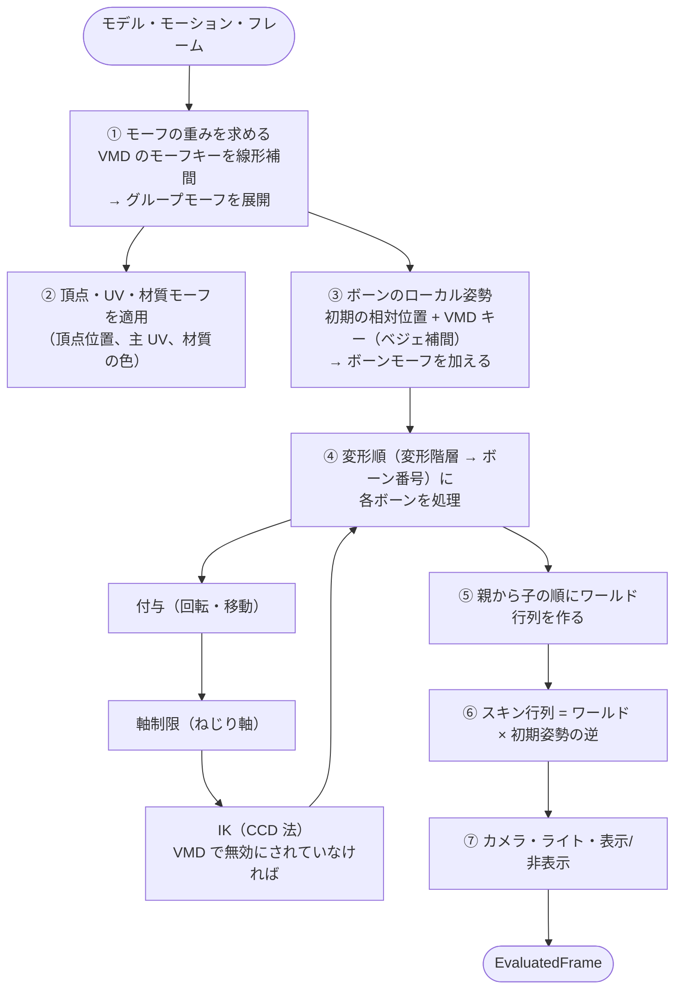

# アニメーション評価

`mmd-animation` は、モデルとモーションと時刻（フレーム）を受け取り、その時刻の姿勢を計算します。

入口は `evaluate(model, motion, frame)` で、結果は `EvaluatedFrame` です。

物理はこのクレートでは扱わず、結果を受け取った `mmd-physics` が上書きします（[physics.md](physics.md)）。

## 時刻

- 時刻は整数のフレーム（`FrameTime`）で、1 秒 = 30 フレームです。
- 再生中も、フレームとフレームの間（小数のフレーム）は評価しません。60 FPS で表示していても、体の動きは 30 フレーム/秒で更新されます。
- キーより前のフレームでは最初のキーの値、最後のキーより後では最後のキーの値を使います。

## 評価の流れ

`EvaluatedFrame` には次が入ります。

| フィールド | 内容 |
| --- | --- |
| `positions` / `uvs` | モーフ適用後の頂点位置と主 UV（モデル空間。スキニング前） |
| `skin` | ボーンごとのスキン行列 |
| `bone_translation` / `bone_rotation` | ボーンのワールド位置と回転（物理の入力と出力に使う） |
| `materials` | 材質モーフ適用後の材質の値 |
| `morph_weights` | グループモーフ展開後のモーフの重み |
| `visible` | モデルを表示するか（VMD の表示キー） |
| `camera` / `orthographic_camera` | カメラの位置・注視点・画角、正投影キーかどうか |
| `light_direction` | 光が進む向き |

## 1. キーフレームの補間

### ボーン

- トラックとボーンは**名前の完全一致**で対応づけます。モデルにない名前のトラックは使いません（左パネルに、一致したボーンの数を表示します）。
- 前後のキーの間を、**後ろのキー**が持つベジェ曲線で補間します。位置は X・Y・Z の 3 本の曲線、回転は 1 本の曲線で球面線形補間（slerp）します。
- VMD の補間データでは、Z と回転の x1 をバイト 17 と 18 から読みます。MMD が書き出すファイルでは 1 行目のバイト 2 と 3 が 0 なので、そこを読むと曲線が崩れるためです。

### モーフ

- モーフのキーは**線形補間**します。
- トラックとモーフは名前の完全一致で対応づけます。

## 2. モーフ

| 種類 | 処理 |
| --- | --- |
| グループ | 自分の重み × 係数を、対象モーフの重みに加える（ファイル順に 1 回） |
| 頂点 | 頂点位置にオフセット × 重みを加える |
| UV | **主 UV だけ**にオフセット × 重みを加える。追加 UV のモーフは読み込むが使わない |
| ボーン | 位置にオフセット × 重みを加え、回転は「単位回転から目標回転へ重みぶん slerp したもの」を前から掛ける |
| 材質 | 加算型は値 + オフセット × 重み。乗算型は値から「値 × 係数」へ重みぶん補間。対象が -1 なら全材質に適用 |

## 3〜4. ボーンの変形

ボーンは**変形階層（layer）の小さい順、同じ階層ではボーン番号の小さい順**に処理します。1 本のボーンにつき、次の 3 つを順に行います。

### 付与（回転付与・移動付与）

- 回転: 付与親の回転を `付与率` 乗したもの（軸角度表現で角度に付与率を掛ける）を掛けます。「ローカル付与」フラグがあると掛ける順番が変わります。
- 移動: 付与親の「初期位置からの移動量」× 付与率を加えます。

### 軸制限

軸制限ボーン（ねじり軸など）は、回転を指定軸まわりの成分だけに制限します（クォータニオンのベクトル部を軸に射影します）。

### IK（CCD 法）

- ファイルに書かれた反復回数だけ、IK リンクを順に回します。
- 各リンクで「エフェクタへの向き」を「目標への向き」に合わせる回転を求め、1 回あたりの角度をファイルの制限角度以下に抑えます。
- 角度制限を持つリンクは、**ローカル X 軸のヒンジ**として扱います。最小値と最大値の X 成分で制限し、Y と Z の回転は 0 にします。これは MMD の古典的なリンク制限です。
- PMD では、名前に「ひざ」を含むボーンに X 軸 -π〜0 のヒンジを付けます（PMD の慣例的な読み込み規則）。
- VMD の IK キーで OFF にされた IK は解きません。

## 5〜6. ワールド行列とスキン行列

- 親から子の順にワールド行列を作ります。
- スキン行列は `ワールド行列 × 初期姿勢のワールド行列の逆` です。初期姿勢は「初期の相対位置・回転なし」です。
- 頂点の変形（スキニング）は GPU のシェーダーで行います。BDEF1 / 2 / 4、SDEF、QDEF に対応しています。同じ式を CPU 側（`skin_vertex`）にも持ち、テストに使っています。
  - SDEF: 変形した中心 C の混合、`位置 − C` の回転の混合、変形した R 点の混合と回転による予測の差、の合計。
  - QDEF: 各ボーンの剛体変換をデュアルクォータニオンで混合。
  - これらの式は単位変換と 1 ボーンのテストを通っていますが、MMD 本体とは照合していません。

## 7. カメラ・ライト・表示

### カメラ

- 現在のフレームを挟む 2 つのキーを、後ろのキーの 6 本の曲線（注視点 X・Y・Z、回転、距離、画角）で補間します。
- カメラ位置は `注視点 + R × (0, 0, -距離)` です。R は XYZ 順のオイラー角から作ります。
- 1 フレームしか離れていないキー同士はカットとして扱われます（整数フレームで評価するので、間を補間しません）。
- **正投影のキーは投影に使いません**。正投影のキーが有効な間は、「カメラモーションに従う」が ON でもエディタカメラのままで、左パネルにその旨を表示します。

### ライト

- 現在のフレーム以前で最後のライトキーの向きを使います（補間しません）。
- ライトキーがない場合の向きは `normalize(0.2, -1, 0.4)` です。これは光がやや奥（+Z）へ向かう、つまり顔の正面上から当たる向きで、**MMD の既定値ではありません**（MMD の既定は `(-0.5, -1, 0.5)`）。
- ライトの色は描画側で MMD の既定値（154/255）に固定しています（[rendering.md](rendering.md)）。

### 表示・非表示

VMD の表示キー（IK キーと同じブロック）で、モデル全体の表示を切り替えます。

## 物理との関係

- 「物理後」に変形するボーンも、同じ 1 回の評価で計算します。物理の結果を待ってから変形し直すことはしていません。
- 評価結果を受け取った `mmd-physics` が、動的剛体が動かすボーンを上書きします。

## 未対応・未照合のもの

- 外部親ボーンは評価しません。外部親を持つボーンは自分のキーだけで動き、読み込み時にログへ警告を出します。
- 追加 UV は読み込みますが、描画にも UV モーフにも使いません。
- ローカル軸は読み込んで保持しますが、変形には使いません（将来のギズモ用）。
- 姿勢、IK、SDEF / QDEF の結果は、MMD 本体と数値で照合していません。
