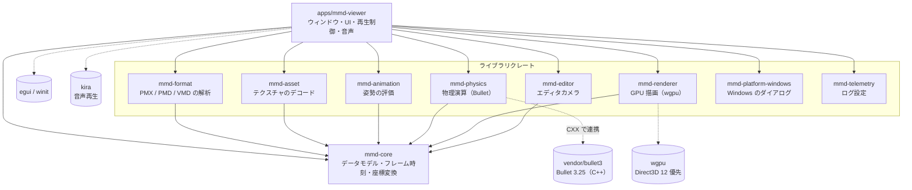
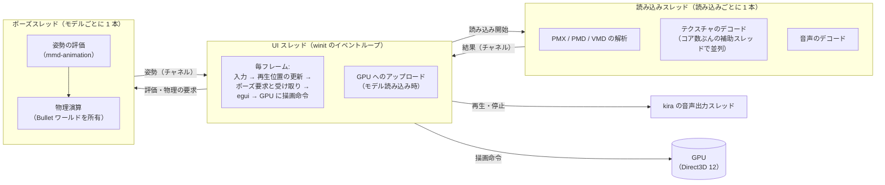

# 全体像（アーキテクチャ）

この文書では、MMD Viewer がどのような部品（クレート）でできていて、それぞれが何を担当し、どのスレッドで動くのかを説明します。

処理の時間的な流れは [workflow.md](workflow.md) を参照してください。

## 1. 構成の考え方

MMD Viewer は Cargo ワークスペースで、1 つのアプリケーション（`apps/mmd-viewer`）と、責務ごとに分けたライブラリクレート（`crates/*`）でできています。

- `mmd-viewer` **が全体を組み立てる**。ウィンドウ、UI、読み込み、再生の制御を持ち、各ライブラリを呼び出します。
- `mmd-core` **が共通のデータモデル**です。モデル、モーション、フレーム時刻、座標変換を持ちます。ファイル解析、GPU、ウィンドウ、Windows API には一切依存しません。
- **ほかのライブラリは** `mmd-core` **だけに依存**し、ライブラリ同士は依存しません。たとえば描画（`mmd-renderer`）は物理（`mmd-physics`）を知りません。

## 2. クレート構成図

矢印は「依存する」を表します。外部ライブラリは主なものだけを書いています。

## 3. 各クレートの責務

| クレート | 担当すること | 担当しないこと |
| --- | --- | --- |
| `mmd-core` | `ModelAsset`（頂点・材質・ボーン・モーフ・剛体・ジョイント）、`Motion`（各キーフレーム）、`FrameTime`、ビュー行列からクリップ行列への変換 `wgpu_clip_from_view` | ファイル解析、アニメーション評価、GPU |
| `mmd-format` | PMX 2.0 / 2.1、PMD、VMD の解析。範囲外の参照、切り詰められたファイル、NaN / 無限大、過大な個数を型付きエラーで拒否 | 剛体のシミュレーション、VPD、PMM |
| `mmd-asset` | 材質テクスチャと共有トゥーン（`toon01.bmp`〜`toon10.bmp`）のデコード、ミップマップの生成。テクスチャは全コアで並列にデコード | GPU への転送 |
| `mmd-animation` | 指定フレームの姿勢の評価。キー補間、モーフ、付与、軸制限、IK、スキン行列、カメラとライトのキー | 物理 |
| `mmd-physics` | Bullet 3.25 による剛体とジョイントの計算、計算結果のボーンへの書き戻し | アニメーション評価 |
| `mmd-renderer` | wgpu の初期化、ビューポート、グリッド、モデルの描画パス（材質、輪郭線、セルフシャドウ、地面影） | UI、ファイル解析 |
| `mmd-editor` | 軌道カメラ（回転、平行移動、ズーム、リセット） | 選択、ギズモ、Undo（未実装） |
| `mmd-platform-windows` | エラーダイアログ、ファイルを開くダイアログ | — |
| `mmd-telemetry` | `tracing` の設定。標準エラー出力と `logs/` への日次ログ | — |
| `apps/mmd-viewer` | winit のイベントループ、egui の UI、セッション（読み込み・再生・物理の制御）、音声再生、毎フレームの描画の組み立て | — |

### `mmd-viewer` 内部のモジュール

| ファイル | 内容 |
| --- | --- |
| `main.rs` | ログを初期化し、アプリを起動する。致命的なエラーはダイアログで表示する |
| `app.rs` | winit のイベント処理、GPU とビューポートの管理、毎フレームの描画、フレーム間隔の制御 |
| `session.rs` | 読み込んだモデル（アクター）、モーション、再生位置、物理の状態。モデルごとのワーカースレッドへの要求と受け取り |
| `ui.rs` | 日本語の UI（メニュー、左パネル、ビューポート、舞台ウィンドウ） |
| `audio.rs` | kira による音声のデコードと再生 |

## 4. 依存方向のルール

1. `mmd-core` はどのクレートにも依存しない（`glam` と `thiserror` のみ）。
2. ライブラリクレートは `mmd-core` と外部ライブラリにだけ依存する。ライブラリ同士の依存は作らない。
3. すべてを組み合わせるのは `mmd-viewer` だけ。
4. 循環依存は作らない。
5. Windows 固有の処理は `mmd-platform-windows` に閉じ込める（GPU のバックエンド選択は `mmd-renderer`）。

この方針により、たとえばアニメーション評価や物理は、ウィンドウも GPU もない状態で単体テストできます。

## 5. スレッド構成

UI スレッドを止めないよう、重い処理は別スレッドで動かします。

| スレッド | 数 | 役割 | 生存期間 |
| --- | --- | --- | --- |
| UI スレッド | 1 | イベント処理、UI、再生制御、GPU への命令 | アプリの起動から終了まで |
| 読み込みスレッド | 読み込みごとに 1 | ファイル解析、テクスチャ・音声のデコード | 1 回の読み込みが終わるまで |
| テクスチャ補助スレッド | CPU のコア数まで | テクスチャの並列デコード（`std::thread::scope`） | テクスチャ読み込みの間 |
| ポーズスレッド | モデルごとに 1 | 姿勢の評価と物理演算。Bullet ワールドはこのスレッドの中で作られ、外に出ない | モデルを外すまで |
| 音声出力スレッド | 1 | kira（cpal）が音声デバイスに出力する | 音声を読み込んでから終了まで |

### 同時に読み込めるのは 1 件だけ

読み込み中にもう 1 件開こうとすると、「読み込み中です」と表示して受け付けません。

### ポーズスレッドとの同期

UI スレッドは、全モデルのポーズスレッドに要求を送ってから、全員の結果を待ちます。複数のモデルは並列に計算されますが、描かれる 1 フレームは必ず全モデルの計算が終わったものです。そのため、体と髪のタイミングがずれることはありません。詳しい流れは [workflow.md](workflow.md) の「再生中の 1 フレーム」を参照してください。

## 6. データの持ち方

| データ | 持ち主 | 共有の方法 |
| --- | --- | --- |
| `ModelAsset`（解析済みのモデル） | `Arc` で UI スレッドとポーズスレッドが共有 | 読み取り専用 |
| `Motion`（解析済みのモーション） | `Arc` で UI スレッドとポーズスレッドが共有 | 読み取り専用。差し替え時はポーズスレッドに新しい `Arc` を送る |
| `PhysicsWorld`（Bullet ワールド） | ポーズスレッドだけ | 共有しない |
| `EvaluatedFrame`（評価結果） | ポーズスレッドで作り、UI スレッドへ移動 | チャネルで受け渡し |
| GPU 資源（頂点バッファ、テクスチャ、パイプライン） | UI スレッドの `SkinnedModel` | 共有しない |

CPU 側のデータ（`mmd-core`）と GPU 側の資源（`mmd-renderer`）、ファイルの内容（`ModelAsset`）と実行時の状態（姿勢や物理）は、それぞれ別の型に分けています。

## 7. GPU の初期化

1. ウィンドウを作ったときに一度だけ、UI スレッドで GPU を初期化します。スワップチェーンが最初のフレームより前に必要なためです。
2. まず Direct3D 12 のアダプタを要求します。失敗したらログに残し、wgpu の主要なバックエンド（`PRIMARY`）で再試行します。
3. 使用中のアダプタ、バックエンド、Direct3D 12 を使えているかどうかは、左パネルに表示されます。

モデルやモーションの読み込みは、この初期化の経路を通りません。
