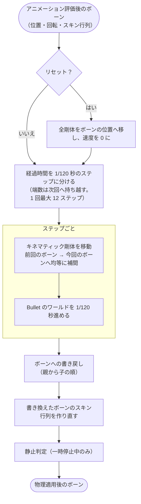
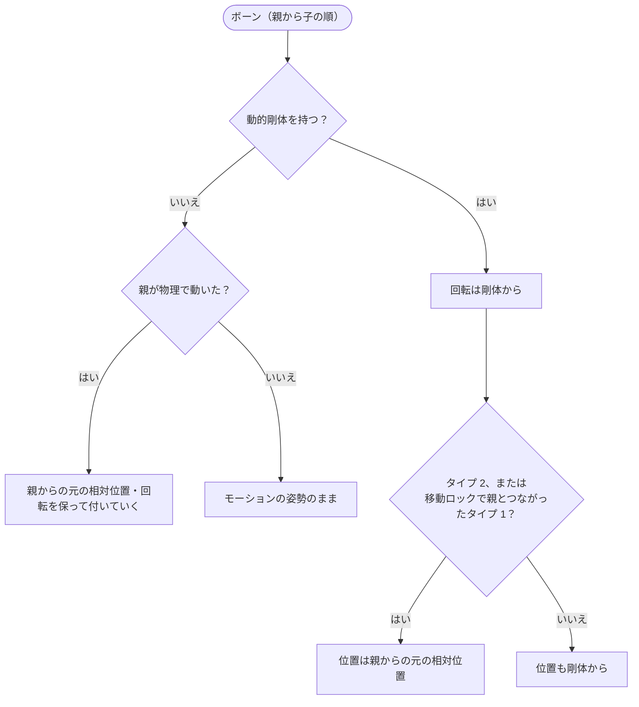

# 物理演算

`mmd-physics` は、モデルに保存された剛体とジョイントを **Bullet 3.25**（`vendor/bullet3` サブモジュール）で計算します。

Bullet は C++ のライブラリで、`build.rs` がビルドし、CXX で Rust とつないでいます（`src/bullet.rs` と `src/bullet_world.cpp`）。

採用の経緯は [ADR 0004](../adr/0004-bullet-physics-backend.md) を参照してください。

Bullet の使い方は、MMD 互換の実装（MMDAgent、saba、babylon-mmd）に合わせています。

数値の一部は、MMD 本体と照合したものではなく、手元の配布モデルで測って決めた値です。そうした値には **（調整値）** と書いています。

## 1. 全体の流れ

## 2. 時間の進め方

物理は MMD と同じく、**モーションの時計**に合わせて進みます。

| 項目 | 値 |
| --- | --- |
| 1 ステップの長さ（`STEP_SECONDS`） | 1/120 秒 |
| モーション 1 フレーム（1/30 秒）あたり | 4 ステップ |
| 1 回の呼び出しの上限 | 12 ステップ（超えた時間は捨てる） |
| 端数の時間 | 次の呼び出しへ持ち越す |

- **再生中**: モーションのフレームが進んだときだけ、1/30 秒ぶん進めます。フレームが進まない表示ティックでは進めません。表示が遅れて 2 フレーム以上進んだ場合も、1/30 秒（4 ステップ）だけです（[workflow.md](workflow.md) の「遅れたときの扱い」）。
- **キネマティック剛体の補間**: 1 回の呼び出しの中で、キネマティック剛体を前回のボーンから今回のボーンへ均等に動かします。30 フレーム/秒のモーションが「1 ステップで一気に動いて残りは止まる」ことにならず、髪やスカートが滑らかに追従します。
- **一時停止中**: 表示の経過時間（最大 0.1 秒）で進め、髪や布を現在の姿勢に落ち着かせます。

## 3. ワールドの設定

| 項目 | 値 | 理由 |
| --- | --- | --- |
| 重力 | (0, -98, 0) | 9.8 m/s² を MMD の単位（10 単位 / m）に換算 |
| ソルバー | Bullet の逐次インパルス法、ウォームスタートあり | Bullet の既定 |
| 反復回数 | 1 ステップあたり 7 回（調整値） | 下記「柔らかさの調整」 |
| ジョイントの制限の ERP | 全 6 軸で 0.1 | 1/120 秒で 0.1 = Bullet 既定（1/60 秒で 0.2）と同じ「1 秒あたりの補正量」 |
| 床 | 80 × 2 × 80 の箱。上面が y = 0。摩擦 0.9 | 髪や裾が床を突き抜けないように |
| 床の衝突グループ | ビット 16（PMX の 16 グループの外） | すべての動的剛体のマスクに床を加える |
| スリープ | しない（`DISABLE_DEACTIVATION`） | MMD 互換の実装と同じ |

### 柔らかさの調整（なぜこの値か）

配布モデルの長い髪の鎖は、根元の 1 つ以外のジョイントが**全軸 0 でロック**されています。それでも MMD では髪が背中に沿って垂れます。これは Bullet のソルバーが完全には収束せず、ロックしたジョイントが 1 節ごとに数度ずつたわむためです（重力を 0 にすると鎖はまったく動かないので、ジョイントの座標系は正しく、たわみはソルバーの柔らかさだけから来ています）。

そのため、ジョイントを固くしすぎると髪が垂れず、柔らかすぎると震えや伸びが出ます。手元のモデルで測った結果は次のとおりです。

| 設定 | 長い髪の垂れ方 | 静止時の震え | アホ毛の垂れ |
| --- | --- | --- | --- |
| 1/120 秒・ERP 0.475・反復 20 | ほぼ垂れない | 大きい | — |
| 1/60 秒・Bullet 既定（ERP 0.2・反復 10） | よく垂れる（鉛直から約 12°） | 中 | — |
| 1/120 秒・ERP 0.1・反復 5 | 1/60 秒とほぼ同じ | 約半分 | 18〜52° |
| **1/120 秒・ERP 0.1・反復 7（現在）** | ほぼ同じ（12.0° → 13.6°） | 約半分 | **10〜18°** |

刻みを 1/120 秒にすると、ダンス中に剛体が体へめり込む深さも半分以下になりました。反復 7 回は、短い鎖（アホ毛など）がカールを保てる程度に固く、長い髪の垂れ方はほとんど変わらない値です。

## 4. 剛体

| 項目 | 設定 |
| --- | --- |
| 形状 | 球、箱、カプセル。カプセルの高さは両端の半球を除いた円柱部分 |
| 質量 | ファイルの値（動的剛体は最小 0.001）。キネマティック剛体は 0 |
| 減衰 | ファイルの値を 0〜1 に制限し、Bullet 既定の式 `v *= (1 − d)^dt` で適用 |
| 追加減衰 | 動的剛体で有効（`m_additionalDamping`）。MMDAgent・saba と同じ |
| 摩擦・反発 | ファイルの値（摩擦は 0 以上、反発は 0〜1 に制限） |
| 衝突グループ | `1 << グループ番号` |
| 衝突マスク | ファイルの値のまま（動的剛体には床のビットを追加） |
| 回転の合成順 | `Ry × Rx × Rz`（Direct3D の yaw・pitch・roll） |

### 減衰の式について

Bullet には `v *= max(1 − dt × d, 0)` という古い式もあり（`BT_USE_OLD_DAMPING_METHOD`）、以前はこちらを使っていました。PMX の減衰値（0.5〜0.99 が多い）では 1/120 秒あたり 99% 以上の速度が残り、髪がいつまでも暴れていました。現在は定義せず、既定の指数の式を使います。

### 回転の合成順について

ファイルの 3 つの角度をどの順で合成するかで、カプセルやジョイントの向きが変わります。3 体の配布モデルで、カプセルの軸と「Y 軸のねじりだけをロックしたジョイント」のねじり軸が、ボーンの向きとどれだけ一致するかを比べました。

| 合成順                        | ジョイントのねじり軸の一致度（モデル A / B） |
| -------------------------- | ------------------------- |
| Bullet の `setEulerZYX`（以前） | 0.80 / 0.97               |
| `Ry × Rx × Rz`**（現在）**     | **0.89 / 0.995**          |

順番を間違えると、ねじり軸ではなく振り軸がロックされ、髪が背中側へ倒れられなくなります。

### 剛体タイプ

| タイプ | 名前 | 動き方 |
| --- | --- | --- |
| 0 | ボーン追従 | キネマティック。ボーンに合わせて動き、ほかの剛体を押す |
| 1 | 物理演算 | 動的。ボーンは剛体の位置と回転を受け取る |
| 2 | 物理 + ボーン位置合わせ | 動的。ボーンは剛体の**回転だけ**を受け取り、位置は親ボーンからの元の相対位置を保つ |

キネマティック剛体はモーションステート経由で動かすので、Bullet はその速度を計算し、接触やジョイントに反映します。

## 5. ジョイント

`btGeneric6DofSpringConstraint` を使い、剛体 A のフレームを移動の基準にします。

| ファイルの制限 | 扱い |
| --- | --- |
| 最小 = 最大 | その軸をロック（ただし上記のとおりソルバーの柔らかさの分だけたわむ） |
| 最小 < 最大 | その範囲に制限 |
| 最小 > 最大、または非有限 | 自由 |

ジョイントの種類による扱い:

| 種類 | 扱い |
| --- | --- |
| 0（バネ付き 6DOF）・1（6DOF） | ファイルの制限をそのまま使う |
| 2（点）・3（円錐ねじれ） | 移動をロック |
| 4（スライダー） | 回転をロック |
| 5（ヒンジ） | 移動と、回転の X 以外をロック |

- **バネ**: 剛性が正の軸でバネを有効にします。Bullet はバネをモーターとして働かせるので、制限の端に当たっている軸ではバネが効きません。
- **つないだ剛体同士の衝突**: 一律には無効にせず、衝突マスクに従います（MMD と同じ）。

## 6. ボーンへの書き戻し

ステップの後、ボーンを親から子の順にたどって書き戻します。

### 移動ロックのリンクは長さを保つ（MMD とは異なる独自の補正）

タイプ 1 のボーンで、その剛体が「親ボーンの剛体」と**移動 3 軸すべてをロックしたジョイント**でつながっている場合は、剛体の回転だけを受け取り、位置は親からの元の相対位置にします。

ファイル上ではこのリンクの長さは変わらないはずですが、柔らかいソルバーでは剛体同士が離れ、スキニングされたテクスチャが一緒に伸びていました（静止状態のスカートで最大 97%）。垂れ方は回転の積み重ねで決まるので、この補正をしても見た目の垂れ方は変わらず、10 体の配布モデルで静止時の伸びは平均 0.3% 未満になりました。

## 7. リセットと静止判定

**リセット**（全剛体をモーションの姿勢へ移し、速度を 0 にする）は、次のときに行います。

- モーションを読み込んだとき
- 停止（フレーム 0 へ戻る）、再生が最後まで行ってフレーム 0 に戻ったとき
- 物理の ON / OFF を切り替えたとき
- 「物理リセット」を押したとき

**静止判定**: 一時停止中、すべての動的剛体の速度が「並進 0.04 未満かつ回転 0.05 未満」の状態が 90 ステップ（0.75 秒）続くと、静止と判断して速度を 0 にし、モーションの姿勢が変わるまで計算を止めます。

## 8. 性能

- 物理はモデルごとのポーズスレッドで動き、複数のモデルは並列に計算されます（[overview.md](overview.md)）。
- 1 モーションフレーム（4 ステップ）の計算時間の目安: 剛体約 500 個のモデルで約 8 ms、約 850 個のモデルで約 21 ms。
- Bullet 本体は `build.rs` で常に最適化（`/O2`）してビルドします。

## 9. 既知の課題

- MMD 本体とは数値で照合していません。上記の数値は、手元の配布モデル 10 体と数曲のダンスで測ったものです。
- 横方向にもジョイントでつながったスカート（網目状の鎖）は、静止状態でもわずかに揺れ続けます（以前の約半分まで減らしています）。
- 移動に可動範囲のあるリンクや、ボーンの親子関係と一致しないリンクは、まだ伸びることがあります。
- 速い動きでは、小さな剛体が体にめり込むことがあります。
- 長い鎖のジョイントの柔らかさは、ソルバーの反復回数と刻み幅に依存します。設定を変えると垂れ方が変わります。
