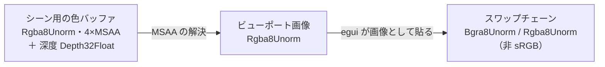
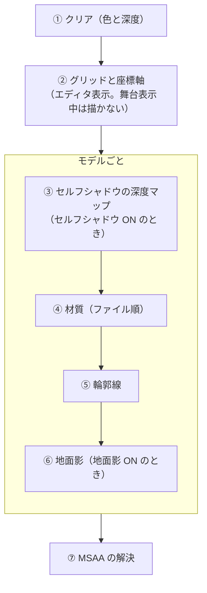
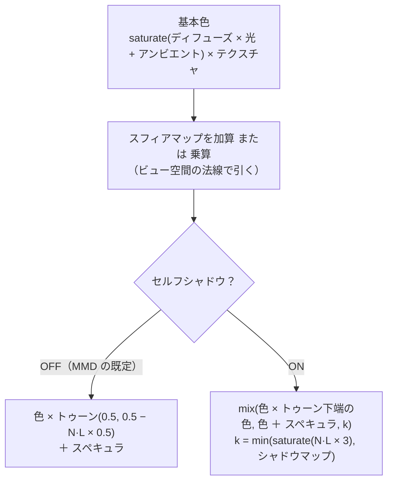

# 描画

`mmd-renderer` は wgpu（Direct3D 12 優先）でビューポートとモデルを描きます。

シェーダーは `assets/shaders/model.wgsl`（モデル）と `assets/shaders/editor_grid.wgsl`（グリッド）です。

## 1. 描画先と合成

- シーンは `Rgba8Unorm` の色バッファと `Depth32Float` の深度バッファに描きます。デバイスが対応していれば 4× MSAA にし、最後に解決します。
- 解決した画像を egui が UI の一部として画面に貼ります。egui はこの画像の**アルファ値を使って合成**するので、モデルの描画でアルファが 1 未満の穴を作らないようにしています（後述）。
- スワップチェーンは非 sRGB 形式を選びます。MMD と同じく色をそのままの値で扱い、ガンマ変換を二重にかけないためです。
- 「舞台」ウィンドウは同じビューポート画像を別の egui ウィンドウに貼るだけで、二重には描きません。

## 2. 描画パス

1 フレームの描画は、次のパスに分かれています。モデルの描画パスはモデルごと（読み込み順）に繰り返します。

| パス | 内容 |
| --- | --- |
| 1. クリア | 色と深度をクリアする |
| 2. グリッド | XZ 平面のグリッドと座標軸。モデルの材質とは別のパス |
| 3. セルフシャドウ | ライト方向からの深度マップ（2048 × 2048）を 1 枚描く。範囲はモデルの頂点の範囲から決める。**MMD のセルフシャドウの方式とは異なる** |
| 4. 材質 | 材質をファイル順に描く（下記「透過」） |
| 5. 輪郭線 | 頂点を法線方向にずらした殻を描く方式（反転ハル）で、表面側を間引いて裏面を描く。カメラに近づいても細い縁取りのままになるよう幅を調整する。折り目用にもう 1 パス描く。**MMD の輪郭線の方式とは異なる** |
| 6. 地面影 | スキニング後の頂点を、ライトの向きに沿って y = 0 の平面へ投影し、45% の不透明度で描く。**MMD のステンシル影とは異なる** |

PMX の三角形は時計回りで、ビューポートもその向きのまま使います。

## 3. 材質のシェーディング（MMD 互換）

材質の色は、MMD の標準シェーダー（MME の `full.fx`）と同じ式で計算します。

| 要素 | 式・扱い |
| --- | --- |
| 光の色 | MMD の既定値 154 / 255 で固定 |
| 基本色 | `saturate(ディフューズ × 光 + アンビエント) × テクスチャ`。MME では「AMBIENT」がファイルのディフューズを、「EMISSIVE」がファイルのアンビエントを返すので、光を掛けるのはディフューズ側 |
| テクスチャ | テクスチャモーフの係数を掛けてから使う |
| スフィアマップ | PMX の指定で加算または乗算。UV は `(n.x × 0.5 + 0.5, 0.5 − n.y × 0.5)` で、n は**ビュー空間**の法線。カメラを回すと反射も一緒に回る |
| スペキュラ | `pow(max(0, N·H), 強度) × スペキュラ色 × 光`。強度 0 のときは足さない |
| トゥーン | 上が明るく下が暗い縦長の画像。光が当たらない面ほど下の行を引く。肌用のトゥーンは下端が暖色で、肌の陰影の色はここで決まる |
| セルフシャドウ | ON のときだけ。光の当たらない面と影の部分を「基本色 × トゥーン下端の色」にする |

### トゥーンがない場合

| ケース | 使うトゥーン |
| --- | --- |
| 材質のトゥーン番号が -1（トゥーンなし） | 白（陰影を付けない。MMD と同じ） |
| 共有トゥーン（`toon01.bmp`〜`toon10.bmp`）がモデルの横にない | 内蔵の縦グラデーション（MMD のトゥーン画像とは異なる）。この欠落は警告しない |
| 指定されたテクスチャが見つからない・読めない | 白。読めない場合はログに残す |

### 以前の式からの変更点

以前は `(アンビエント + ディフューズ × トゥーン(1 − N·L)) × テクスチャ` で、影側を一律 72% の灰色で暗くしていました。そのため影側にトゥーンの暖色が乗らず、肌が白っぽく見えていました。現在の式で長夜月モデルを正面から描くと、脚の肌の色は (235, 230, 229) で、MMD（セルフシャドウ OFF）の (232, 227, 226) とほぼ一致します。

## 4. 透過

MMD と同じく、**すべての材質をファイル順に、アルファブレンドと深度書き込みありで**描きます。

- 半透明の部分は、それより前に描かれたものの上に混ざり、それより後に描かれるものを隠します。何が透けて見えるかは、ファイルの材質の順番で決まります。
- アルファが 1/255 未満の画素は捨て、深度も書きません。完全に透明な層が、その奥の目などを隠さないようにするためです。
- 色は「元の色 × α + 背景 × (1 − α)」で混ぜますが、**アルファ値は 1 に向かって積み上がる**ように混ぜます（`One, OneMinusSrcAlpha`）。egui がビューポート画像をアルファ付きで合成するので、半透明の部分に穴が開いて後ろの UI が透けるのを防ぐためです。

以前はテクスチャのアルファ分布から材質を「不透明・切り抜き・半透明」に自動分類し、切り抜きはアルファ 0.5 未満を捨て、半透明は深度を書かずに描いていました。そのため、フェードするリボンが途中で消えたり、後から描いた服が髪の上に塗られたりしていました。

## 5. テクスチャ

- テクスチャは `Rgba8Unorm` で転送します。
- 色テクスチャは繰り返し（Repeat）、トゥーン・スフィアは端で止める（ClampToEdge）サンプラーを使います。どちらも線形補間と 8× 異方性フィルタです。
- ミップマップは読み込み時に生成して転送します（アルファで重み付けした平均なので、透明な画素が瞳を黒く濁らせない）。**ただし現在のサンプラーは** `lod_max_clamp = 0` **のため、描画では最上位のレベルだけが使われます。**
- `Queue::write_texture` は行を詰めたまま受け取れるので、256 バイト境界への詰め直しはしません。

## 6. GPU への転送

| データ | 転送のタイミング |
| --- | --- |
| 頂点（位置・UV）と材質の値 | モデル読み込み時と、モーフの重みが変わったときだけ |
| ボーン（スキン行列・回転・位置） | 毎フレーム |
| カメラ（クリップ行列・ビュー行列・ライト・カメラ位置） | 毎フレーム |

頂点は、モーフが変わらない限り同じなので、毎フレームは送りません。

## 7. 既知の課題

- セルフシャドウ、輪郭線、地面影は MMD とは異なる方式です。
- セルフシャドウの深度マップの範囲は、モーフ適用後の**初期姿勢**の頂点から決めています。モデルが大きく動くと、影が範囲外になることがあります。
- 描画結果を MMD 本体と画素単位で照合したのは、上記の肌の色の 1 例だけです。
- MME（エフェクト）は未対応です。
