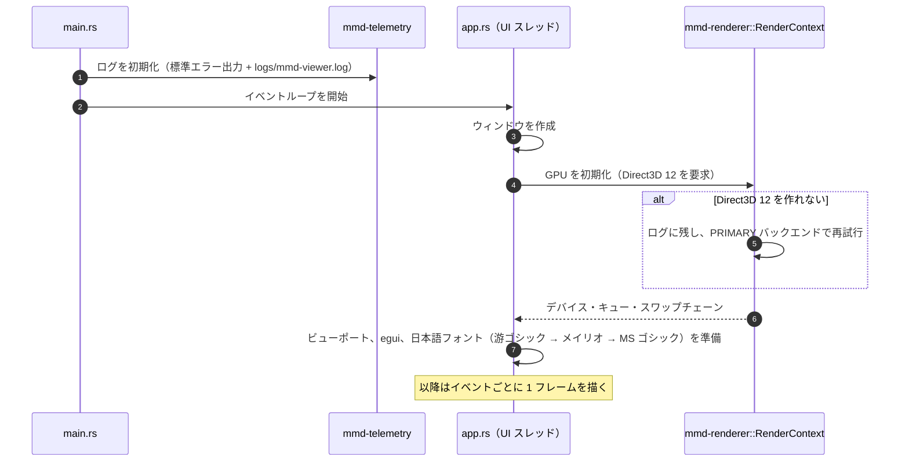
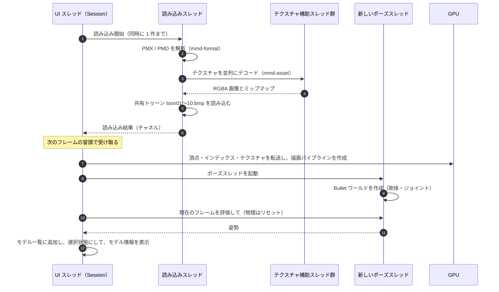
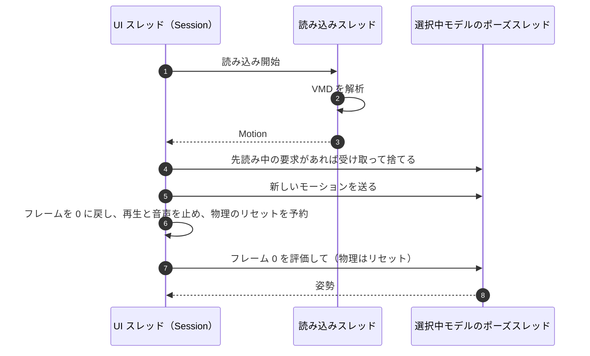
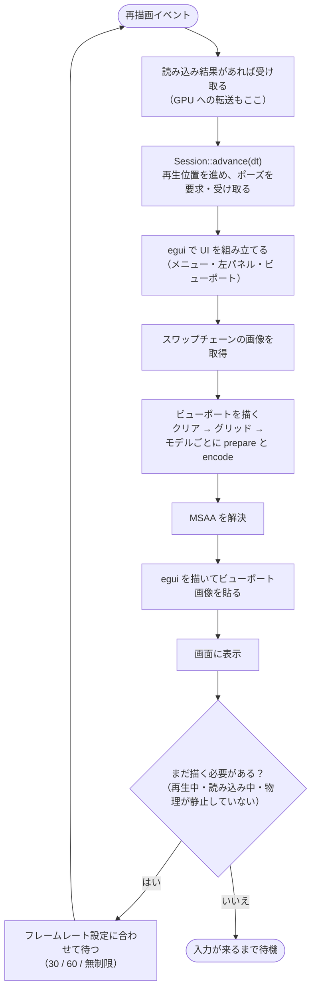
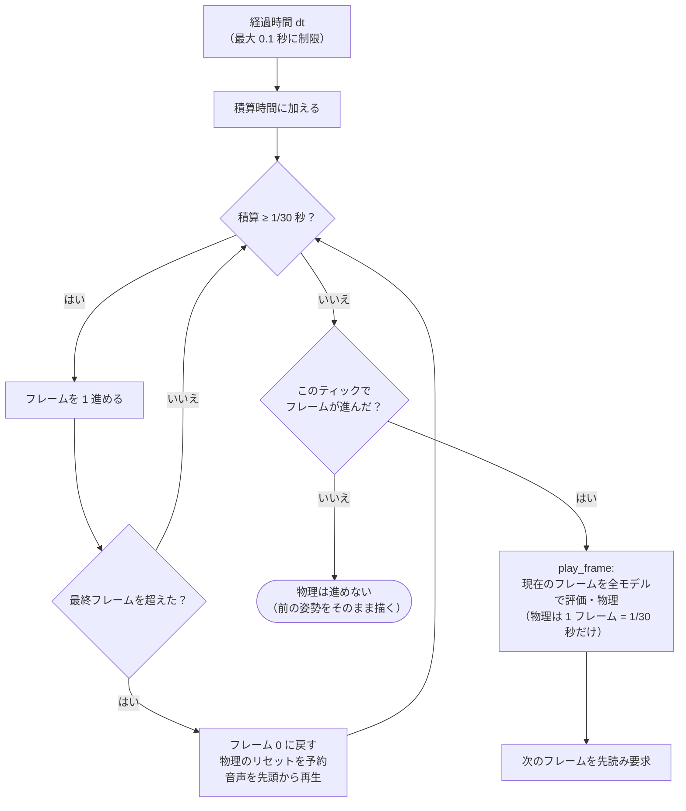
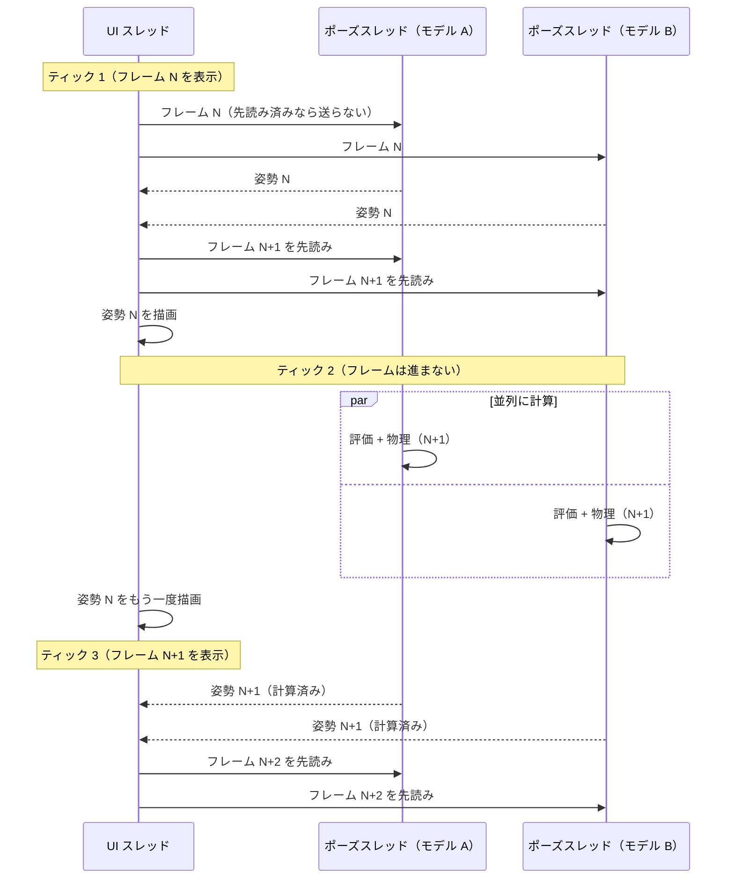
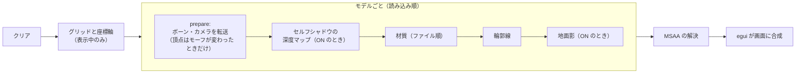

# 実行時のワークフロー

この文書では、アプリの起動から、モデル・モーション・音声の読み込み、再生中の 1 フレームの処理までを、時間の流れに沿って説明します。

部品の構成は [overview.md](overview.md) を参照してください。

## 1. 起動

起動時の GPU 初期化だけは UI スレッドを一度止めます。

致命的なエラー（GPU を一切作れない場合など）は、Windows のダイアログで表示して終了します。

## 2. モデルの読み込み

「ファイル → モデルを追加」か、ウィンドウへのドラッグ＆ドロップ（`.pmx` / `.pmd`）で始まります。

- 解析とデコードは読み込みスレッドで行うので、UI は止まりません。
- GPU への転送だけは UI スレッドで行います（wgpu のキューを使うため）。
- 解析に失敗した場合は、左パネルにエラーの内容を表示します。

## 3. モーションの読み込み

「ファイル → モーションを適用」か、`.vmd` のドラッグ＆ドロップで始まります。モーションは**選択中のモデル**に適用されます（左パネルのモデル一覧で選びます）。

モーションを差し替えると、フレーム 0 の姿勢は前の姿勢から大きく離れていることがあります。

物理をリセットせずに進めると、髪やスカートが体を突き抜けて移動するので、必ずリセットします。

## 4. 音声の読み込み

「ファイル → 音声を開く」か、`.wav` / `.mp3` / `.ogg` / `.m4a` のドラッグ＆ドロップで始まります。

音声は読み込みスレッドで全体をデコードし、UI スレッドで再生用に保持します。

再生はモーションの現在のフレームの位置（フレーム ÷ 30 秒）から始まり、タイムラインと一緒に一時停止・停止します。

## 5. 毎フレームの処理（UI スレッド）

ウィンドウの再描画のたびに、次の順に処理します。

- **フレームレート**: 「表示」メニューで 30 FPS / 60 FPS / 無制限を選べます（既定は 60 FPS）。モーション自体は常に 30 フレーム/秒で進みます。
- **再描画の条件**: 再生中、読み込み中、物理が静止していないときだけ描き続けます。止まっているときは入力が来るまで待機し、CPU と GPU を使いません。

## 6. 再生中の 1 フレーム

再生中は、経過時間を 1/30 秒ずつ積み上げ、モーションのフレームを進めます。

### 先読み（プリフェッチ）の仕組み

60 FPS で表示している場合、モーションのフレームが進むのは 2 回に 1 回です。そこで、フレームを表示した直後に**次のフレームの計算を先に要求**しておきます。ポーズスレッドは、フレームが進まない表示ティックの間に計算を終えるので、次のフレームではほとんど待ちません。

### 遅れたときの扱い

表示が遅れて、1 回の更新でモーションが 2 フレーム以上進んだ場合も、物理は 1 フレーム分（1/30 秒 = 4 ステップ）しか進めません。

- 先読みしていたフレームが現在のフレームと違う場合は、その結果を受け取って捨て、現在のフレームを改めて要求します。
- モーションは飛びますが、キネマティック剛体は 4 ステップかけて前の姿勢から新しい姿勢へ移動するので、物理が破綻することはありません。
- 遅れを取り戻そうと物理を多く進めると、その更新がさらに遅くなり、悪循環で 2 体の再生が 15 FPS 前後まで落ちていました。この制限はそれを防ぐためのものです。

## 7. 一時停止・停止・リセット

| 操作 | 処理 |
| --- | --- |
| 再生 | 再生中にし、音声を再開する（初回は現在のフレームの位置から再生） |
| 一時停止 | 再生を止め、音声を一時停止する。先読み中の要求を捨て、**現在のフレームを評価し直す**（ポーズスレッドが 1 フレーム先へ進んでいる場合があるため） |
| 停止 | フレーム 0 に戻し、音声を止め、物理をリセットしてフレーム 0 を評価する |
| 物理 ON/OFF | 物理をリセットして現在のフレームを評価し直す。OFF のときはモーションの姿勢をそのまま表示する |
| 物理リセット | 剛体をモーションの姿勢に戻し、速度を 0 にする |

### 一時停止中の物理

一時停止中も物理は動き続け、髪や布が現在の姿勢に落ち着くまで計算します。物理の時間は表示の経過時間（最大 0.1 秒）で進めます。すべての動的剛体が 0.75 秒間ほぼ静止すると「静止」と判断し、姿勢が変わるまで計算と再描画を止めます。

## 8. 描画フレームの中身

モデルごとに、次の順で GPU に命令を積みます。詳細は [rendering.md](rendering.md) を参照してください。

