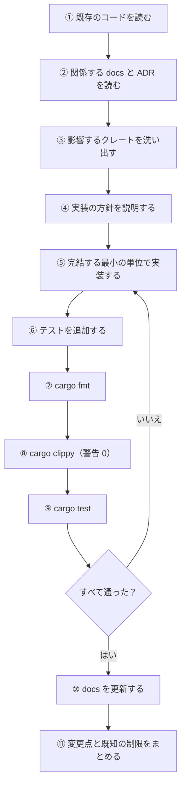
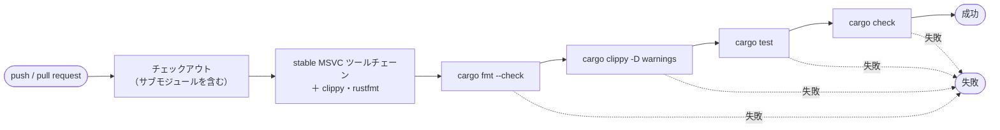

# 開発ワークフロー

この文書は、MMD Viewer の開発の進め方と、変更を取り込むまでに通すチェックをまとめます。

## 1. 1 つの作業の進め方

守ること:

- 関係のないモジュールを書き換えない。
- 公開インターフェースを変えるときは、理由を残す。
- 大きなアーキテクチャの変更には ADR を書く（[docs/adr](../adr)）。
- インターフェースや仮実装だけの段階で「完成」と言わない。
- MMD との互換性を、実装の都合で黙って犠牲にしない。照合していない挙動は、docs に「未照合」と書く。

## 2. 必須のチェック

| コマンド | 確認すること |
| --- | --- |
| `cargo fmt --all -- --check` | 整形と改行コード（LF） |
| `cargo clippy --workspace --all-targets --all-features -- -D warnings` | 警告 0。抑止する場合は理由をコメントに書く |
| `cargo test --workspace` | 全テスト |
| `cargo check --workspace` | 型チェック |

`unsafe` は原則として使いません。必要な場合は、範囲を最小にして閉じ込め、安全性の前提を書き、テストを付けます（Bullet との連携は CXX が生成するコードに閉じ込めています）。

## 3. CI（GitHub Actions）

`.github/workflows/ci.yml` が、push と pull request のたびに Windows で同じチェックを実行します。

| 項目 | 内容 |
| --- | --- |
| 実行環境 | `windows-latest` |
| チェックアウト | `actions/checkout@v7`。`submodules: recursive` で Bullet も取得 |
| ツールチェーン | `dtolnay/rust-toolchain@stable`（`x86_64-pc-windows-msvc`、clippy、rustfmt） |
| 手順 | 整形 → Clippy → テスト → 型チェック。どれかが失敗した時点で終了 |

Windows ランナーは `core.autocrlf=true` でチェックアウトしますが、`.gitattributes` で LF に固定しているので、改行コードの違いで整形チェックが失敗することはありません。

## 4. テストの方針

`AGENTS.md` は機能ごとにテストを求めています。現在あるテストと、まだないテストは次のとおりです。

| 対象 | 現在あるテスト | まだないテスト |
| --- | --- | --- |
| ファイル解析（`mmd-format`） | PMX・PMD の最小モデル、材質コメントの位置、切り詰め・過大な個数、非有限の値、不明なマジック | 範囲外の参照、不正な文字列、未対応のバージョン、VMD の各ブロック |
| アニメーション（`mmd-animation`） | ベジェ曲線、親子の相対位置、付与、軸制限、頂点モーフ、IK、カメラ位置、BDEF / SDEF / QDEF、地面への投影 | グループ・UV・ボーン・材質モーフ、IK の角度制限、カメラの補間 |
| 物理（`mmd-physics`） | 剛体の回転の合成順、床への落下、キネマティック剛体への着地、脚に押されるスカート、減衰の式、ロックしたジョイントのたわみと長さの保持、タイプ 2 の位置、バネ、ボーンの処理順 | 剛体タイプ・ジョイント種類ごとの網羅、リセットと静止判定 |
| 描画（`mmd-renderer`） | WGSL の検証、頂点レイアウト、グリッド、ミップマップの縮小 | 描画結果の画像比較（GPU が必要） |
| カメラ（`mmd-editor`・`mmd-core`） | 既定位置、回転・ズーム・平行移動の範囲、リセット、不正な入力、射影 | — |

MMD 本体との数値の照合は、まだ自動テストになっていません。見た目だけで互換性を判断しないよう、照合した場合は数値を docs に残します。

## 5. コミット

- 生成物（`target/`）、ログ（`logs/`）、秘密情報を含むファイルはコミットしません。
- モデル・モーション・音声などの配布物は、ライセンスのためリポジトリに入れません。手元で確認に使ったモデル名を docs に書く場合も、ファイル自体は含めません。
